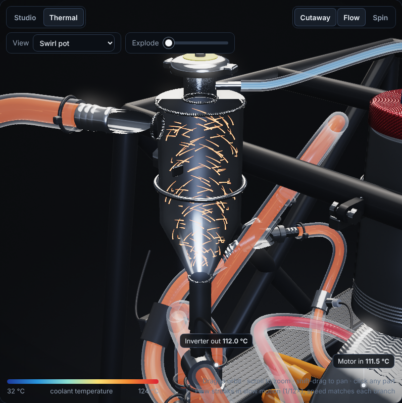

# Cooling Loop Lab

An interactive 3D simulator of the Red Raider Racing FSAE EV (2026–27) cooling loop. Components run top to bottom: swirl pot → EBP40 pump → Y split → EMRAX 228 and DTI HV-500LC in parallel → Y merge → radiator → SPAL fan.

## What it does

- **Hydraulics**: solves the pump curve against the system curve. Hoses use Darcy–Weisbach with the Churchill friction factor, using hose lengths from the 3D routing. The parallel motor and inverter legs are solved for equal pressure drop.
- **Thermal**: marches node by node around the loop until it closes. Radiator heat out comes from the Radiator Flow Lab engine: Chang & Wang j-factor, Kim & Bullard friction, ε-NTU for crossflow, and the SPAL fan curve plus ram air.
- **Checks**: motor and inverter coolant limits, motor flow range, pressures, hose velocities, boiling at cap pressure, and the catch can rule.
- **Transient**: a lumped endurance warm-up with fan hysteresis and a driver change. You can overlay a MoTeC CSV export on it.
- **3D**: a parametric model with a cutaway, explode slider, focus views, and click-to-inspect parts. Coolant is colored by temperature, and the flow streaks move at the solved speed in each branch.

## Layout and CAD inputs

- **Layout, front to back:** swirl pot at the highest point, on the cross tube right behind the firewall, with the pump on the chassis directly under it; then the DTI HV-500 (forward) and the EMRAX 228 (closer to the rear), both inside the chassis; then the radiator, shroud and two 4 in fans, mounted outside the rear of the chassis. The catch bottle sits low inside the frame at the rear right corner. Seen from behind, facing the fans, the swirl pot is on the left. Bay dimensions and the inverter port positions are estimates.
- **Firewall:** no cooling part sits ahead of the firewall plane.
- **Y fittings:** hang on the 3/4 in hose, with no bracket.
- **Sensors:** two temperature sensors, at the radiator inlet and the radiator outlet, and one flow sensor on the return line before the swirl pot inlet.
- **Numbers:** the thermal and hydraulic results are unvalidated model estimates, there to help explain the loop. The airflow still uses the old single SPAL fan curve.
- **EBP40 pump:** proportions come from `Pump_V1.SLDPRT`. It is 145 mm tall, and the outlet barb is 75 mm off-axis.
- **Tabs:** `Tab_1in` is 1.0 × 0.5 in with a Ø0.25 in hole. `Tab_2in` is 2.0 × 1.0 in, 0.075 in thick, with a Ø0.5 in hole. Both are welded to the frame tubes where parts mount.
- **Hose routes:** `tools-route-optimizer.js` finds the routes. It runs offline with Node and searches the Y-fitting orientations, the pump and swirl-pot rotation, and the hose waypoints. It keeps every bend at least about 2 × the hose OD and keeps the hoses clear of the components, the frame and each other. The result is stored as `ROUTE` in `src/layout.js`.

## Run it

`index.html` is one self-contained file. Open it in a browser, or host it with GitHub Pages:

1. Push this repo to GitHub.
2. Go to **Settings → Pages** and choose **Deploy from a branch**, then `main` and `/ (root)`.
3. The site appears at `https://<your-username>.github.io/<repo-name>/`.

## Editing

| File | Contents |
|---|---|
| `src/index.src.html` | Page layout and CSS |
| `src/physics.js` | Radiator engine (from Radiator Flow Lab) |
| `src/layout.js` | Car-bay layout, ports and B-spline hose routes (mm) |
| `src/loopsolve.js` | Pump/system solve, branch split, thermal loop, checks, transient |
| `src/geom.js` | Mesh helpers |
| `src/render_loop.js` | WebGL2 renderer: parts, shadows, SSAO, bloom, picking |
| `src/app.js` | Controls, charts, schematic, tables |

After editing, run `python3 build.py` to regenerate `index.html`.

## Accuracy

These are correlation-based estimates. The page labels every assumption, including minor-loss K values, motor and inverter pressure drop scaling, the interpolated pump curve, and the lumped transient. Confirm results with bench flow tests, CFD and MoTeC data.
