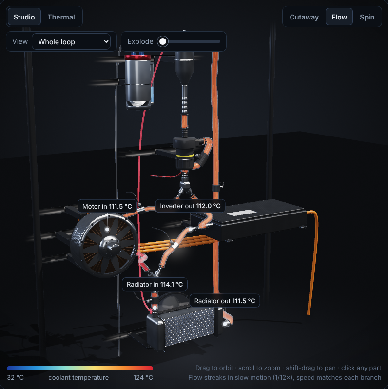

# Cooling Loop Lab

An interactive 3D simulator of the Red Raider Racing FSAE EV (2026–27) cooling loop. Components run top to bottom: swirl pot → EBP40 pump → Y split → EMRAX 228 and DTI HV-500LC in parallel → Y merge → radiator → SPAL fan.

## What it does

- **Hydraulics**: solves the pump curve against the system curve. Hoses use Darcy–Weisbach with the Churchill friction factor, using hose lengths from the 3D routing. The parallel motor and inverter legs are solved for equal pressure drop.
- **Thermal**: marches node by node around the loop until it closes. Radiator heat out comes from the Radiator Flow Lab engine: Chang & Wang j-factor, Kim & Bullard friction, ε-NTU for crossflow, and the SPAL fan curve plus ram air.
- **Checks**: motor and inverter coolant limits, motor flow range, pressures, hose velocities, boiling at cap pressure, and the catch can rule.
- **Transient**: a lumped endurance warm-up with fan hysteresis and a driver change. You can overlay a MoTeC CSV export on it.
- **3D**: a parametric model with a cutaway, explode slider, focus views, and click-to-inspect parts. Coolant is colored by temperature, and the flow streaks move at the solved speed in each branch.

## Run it

`index.html` is one self-contained file. Open it in a browser, or host it with GitHub Pages:

1. Push this repo to GitHub.
2. Go to **Settings → Pages** and choose **Deploy from a branch**, then `main` and `/ (root)`.
3. The site appears at `https://<your-username>.github.io/<repo-name>/`.

## Editing

| File | Contents |
|---|---|
| `src/index.src.html` | Page layout and CSS |
| `src/physics.js` | Radiator engine (from Radiator Flow Lab) |
| `src/layout.js` | Component positions and hose routing (mm) |
| `src/loopsolve.js` | Pump/system solve, branch split, thermal loop, checks, transient |
| `src/geom.js` | Mesh helpers |
| `src/render_loop.js` | WebGL2 renderer: parts, shadows, SSAO, bloom, picking |
| `src/app.js` | Controls, charts, schematic, tables |

After editing, run `python3 build.py` to regenerate `index.html`.

## Accuracy

These are correlation-based estimates. The page labels every assumption, including minor-loss K values, motor and inverter pressure drop scaling, the interpolated pump curve, and the lumped transient. Confirm results with bench flow tests, CFD and MoTeC data.
